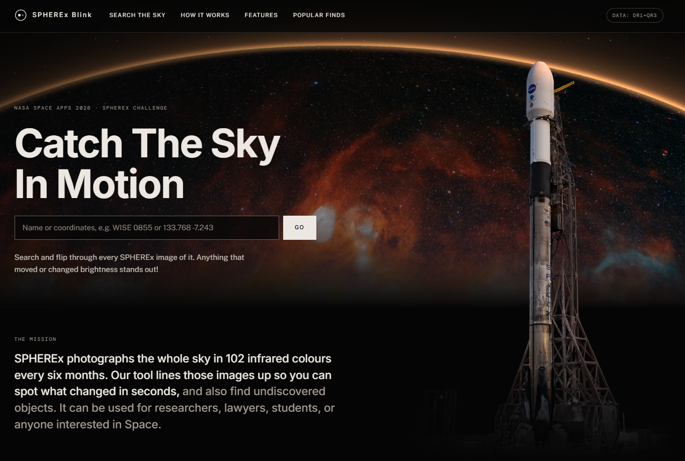
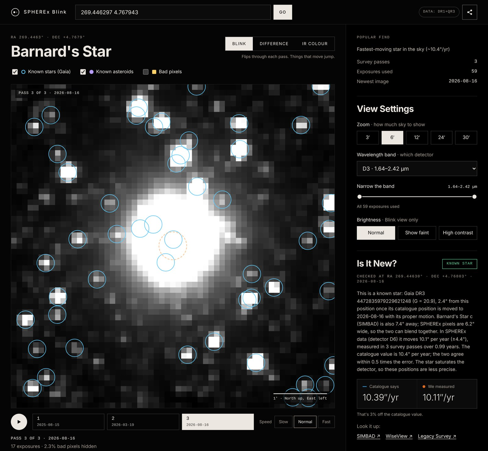
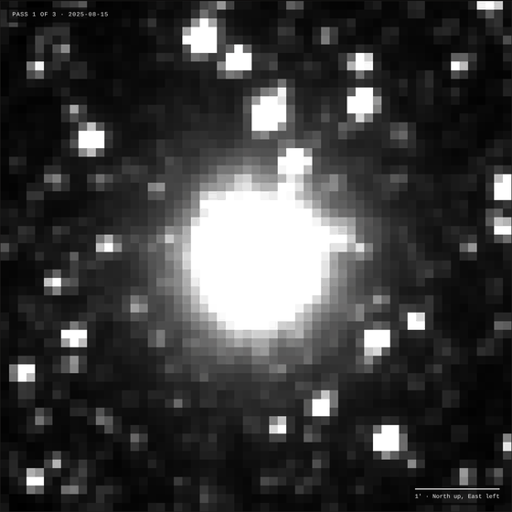
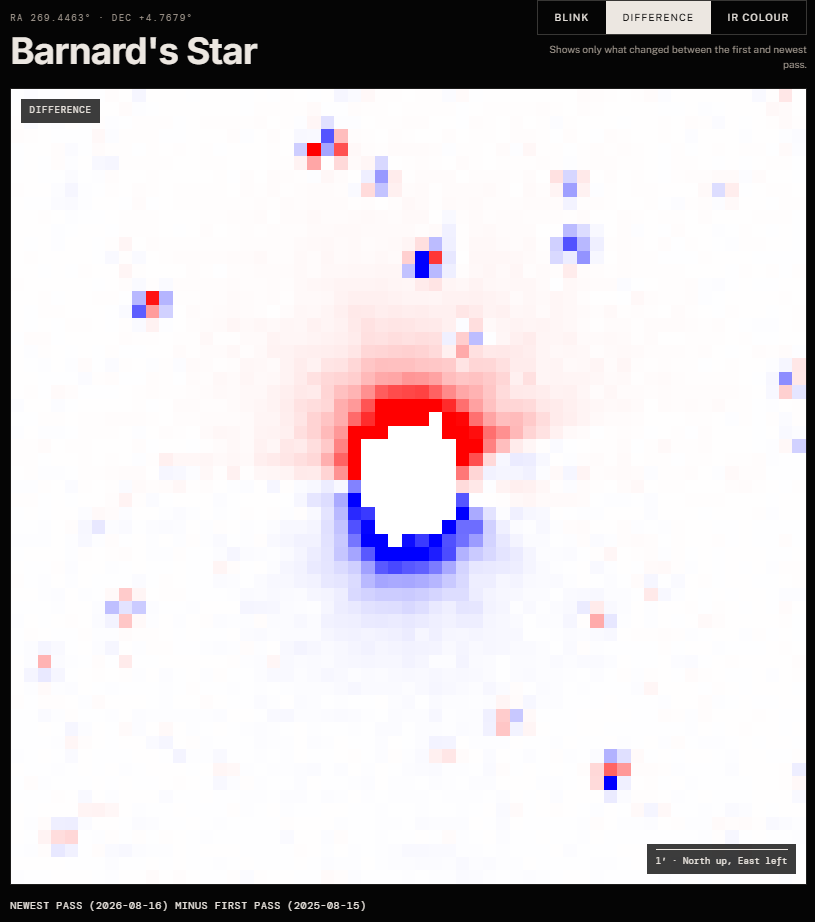
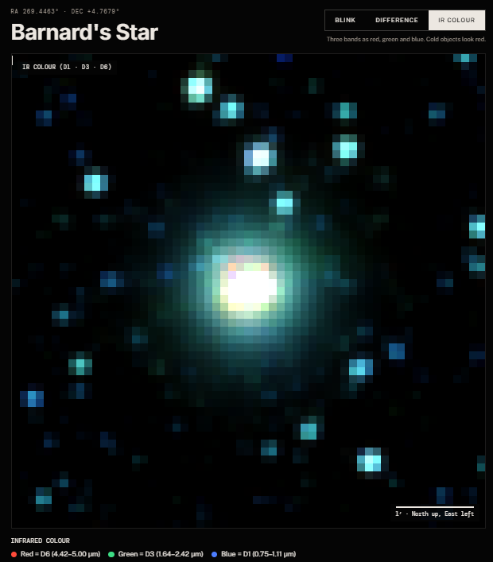
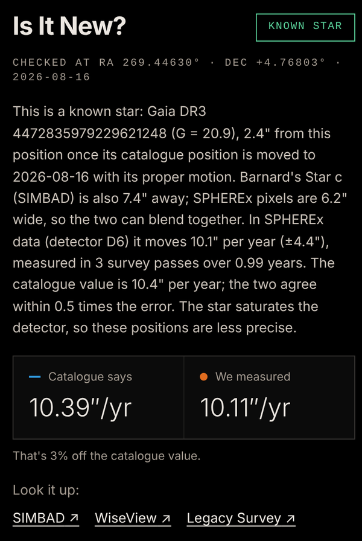

# SPHEREx Blink

SPHEREx Blink is a web tool that allows anyone to flip through NASA's newest infrared sky images captured by the SPHEREx, spot what changed, and check whether an object has already been found or not.

Built by our team Space Penguins for the **NASA Space Apps 2026 (Budapest) Hackathon**! 
Check it out here: https://space-penguins.vercel.app/ .



## The problem

Since 2025, NASA's SPHEREx telescope has photographed the whole sky in 102 infrared colours, and it does so every six months. All of it becomes public within weeks. Stars, brown dwarfs, asteroids and comets give themselves away by shifting between those photos.

However, the data is hard to use. Finding something that moved means downloading millions of raw FITS files, writing code and doing coordinate maths. Students, teachers, space enthusiasts andd busy scientists have no simple way to just look at it.

## Our solution

Simple type the name of a known object or coordinates, and SPHEREx Blink lines up every SPHEREx image of that patch of sky. Press play and anything that moved jumps.



### Blink

The viewer flips between the passes, like astronomers have done for a century. Here are three real SPHEREx passes of Barnard's Star, from August 2025 to August 2026. The big bright star moves north.



### Difference

Subtract one pass from another and everything that stayed still disappears. A moving object turns into a pair: blue where it was, red where it is now.



### Infrared colour

Three SPHEREx bands shown as red, green and blue. Cold objects, like brown dwarfs, look red. This can help us also identify the type of material it is made of.



### Is it new?

Click any dot and the app checks it against Gaia, SIMBAD and the known asteroids at the exact date of the image, then explains the answer in plain words. It can also measure how fast something moves from the SPHEREx images alone. For Barnard's Star it gets 10.1″ a year, against the catalogue's 10.4″.



If nothing matches, the answer is *Unexplained*. That isn't a discovery yet, but it is a lead worth a scientist's time.

You can also see a spectrum across SPHEREx's colours, brightness over time and the motion track. Every view has a shareable link.

## Impact

- **Space enthusiasts and students** get a real chance to find something new in NASA's newest survey, for free and from any device. No matter the education level, age or income.
- **Scientists** get leads that are already checked against the big catalogues, instead of raw pixels.
- **Schools and museums** get real space data from the last few months, ready to explore in two clicks.
- **NASA** gets more people using a mission that's already paid for and flying so the investment is more worth it.


The idea has already works for older data: in NASA's Backyard Worlds project, volunteers flipping through WISE images found more than 3,000 brown dwarfs in the last decade. SPHEREx Blink brings that kind of searching to SPHEREx with even faster results.

## How it works

1. The backend asks NASA's IRSA archive which SPHEREx images cover the spot.
2. It reads only the small pixel box it needs from IRSA's public S3 bucket, with IRSA's cutout service as a fallback.
3. Images are grouped into survey passes, stacked and rendered as PNGs, then cached on disk.
4. For "Is it new?", it queries Gaia DR3 (moved to the image date by proper motion), SkyBoT for asteroids and SIMBAD, and turns the result into a plain-language verdict.

**Stack:** React, Vite, Recharts and Aladin Lite on the frontend. Python and FastAPI on the backend, with Astropy and Astroquery. Hosted on Vercel (frontend) and Azure Container Apps (backend).

## Run it locally

You need Python 3.10+ and Node 18+.

**Backend**

```powershell
cd backend
python -m venv .venv
.venv\Scripts\Activate.ps1          # macOS/Linux: source .venv/bin/activate
pip install -r requirements.txt
uvicorn app.main:app --reload       # real data from IRSA
```

**Frontend**

```powershell
cd frontend
npm install
npm run dev                          # http://localhost:5173
```

By default `frontend/.env` uses mock data, so no backend is needed. To use the real backend, create `frontend/.env.local` with `VITE_USE_MOCK=false` and restart `npm run dev`.

The backend's interactive API reference is at http://localhost:8000/docs.

## Project structure

```
space_penguins/
├── backend/            Python + FastAPI
│   ├── app/routers/      API endpoints (frames, images, analysis, context, explain, …)
│   ├── app/spherex.py    IRSA queries, cutouts, stacking, PNG rendering
│   ├── app/catalogs.py   Gaia, SkyBoT and SIMBAD lookups
│   ├── app/explain.py    plain-language verdicts
│   └── scripts/          precaching and IRSA checks
├── frontend/           React + Vite
│   ├── src/components/   player, charts, verdict, search, …
│   ├── src/pages/        start page, viewer, embed
│   └── src/api/          backend calls and mock data
└── docs/screenshots/   pictures used in this README
```

## Team (Space Penguins)

- **Asuna** – frontend
- **Muna** – frontend
- **Alyem** – backend
- **Qian** – backend

## Credits

- SPHEREx data: NASA/JPL-Caltech, served by NASA/IPAC Infrared Science Archive (IRSA)
- Gaia DR3: ESA/Gaia/DPAC
- SIMBAD: CDS, Strasbourg
- SkyBoT: IMCCE, Paris Observatory
- Sky map: Aladin Lite, CDS
